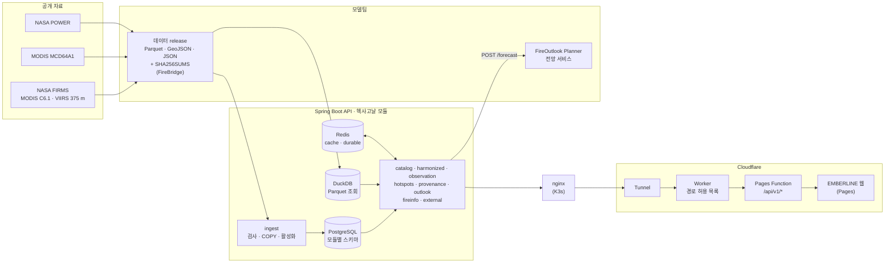

<div align="center">

# 🔥 EMBERLINE — 백엔드

**MODIS–VIIRS 화재 감지를 한 기준으로 맞춰, 공개 API 로 내보낸다.**

[English](README.md) | **한국어**

[](https://www.spaceappschallenge.org/)
[](https://openjdk.org/projects/jdk/21/)
[](https://spring.io/projects/spring-boot)
[](https://spring.io/projects/spring-modulith)
[](https://www.postgresql.org/)
[](https://duckdb.org/)
[](https://redis.io/)
[](https://k3s.io/)
[](https://www.cloudflare.com/)
[](contract/openapi.yaml)

**[🌐 라이브 데모](https://emberline-9sd.pages.dev)** · **[🖥️ 프런트 레포](https://github.com/Nasa-Planetarium/Planetarium-Frontend)** · **[🛰️ 모델 레포](https://github.com/Nasa-Planetarium/Planetarium-AI)** · **[📜 API 계약](contract/openapi.yaml)**

</div>

---

EMBERLINE 은 NASA Space Apps Challenge 2026 과제 **「Harmonization of MODIS and VIIRS Hot Spots」** 에 낸 우리 팀의 답이다.
모델팀이 MODIS 와 VIIRS 위성 화재 감지를 한 기준(VIIRS S-NPP 상당 감지 건수)으로 맞춰 release 파일로 낸다.
이 백엔드는 그 release 를 적재해 지도·캘린더·예년 비교·전망·CSV 용 HTTP API(`/api/v1`)로 내보낸다.

> **계산은 모델이, 서버는 전달만.** 값은 release 파일에서 읽어 **저장된 그대로** 낸다 — 다시 계산하지 않는다.
> 지금 운영 API 는 데이터 release `v1.2-2026-11-15` 를 낸다.

## 목차

- [무엇을 하나](#무엇을-하나)
- [아키텍처](#아키텍처)
- [데이터 흐름](#데이터-흐름)
- [API](#api)
- [오류 규약](#오류-규약)
- [캐시와 속도 제한](#캐시와-속도-제한)
- [빠른 시작](#빠른-시작)
- [배포](#배포)
- [데이터 규칙](#데이터-규칙)
- [표시 이름](#표시-이름)
- [프로젝트 구조](#프로젝트-구조)
- [데이터 출처와 표기](#데이터-출처와-표기)
- [팀](#팀)
- [기여 방식](#기여-방식)

## 무엇을 하나

| | |
|---|---|
| 🗺️ **2000년부터 오늘까지 한 줄의 화재 기록** | MODIS(Terra, Aqua)와 VIIRS(S-NPP, NOAA-20, NOAA-21) 감지를 모델팀의 **FireBridge** 모델이 맞춘 값 — 0.1° 칸별·지역별 월 계열. |
| 📅 **캘린더와 예년 비교** | 불확실성 구간·값 출처·예년 대비 판정이 든 연×월 캘린더, 비교 기준 기간과 연속성을 담은 달별 비교. |
| 📍 **핫스팟과 칸** | 통합 핫스팟 점(JSON/CSV), 0.1° 칸 값(GeoJSON), 칸 FRP(일·월), NASA FIRMS WMS 타일 대리. |
| 🔭 **전망** | 다음 달 발생 확률(0.5° 격자·지역별)과 아무 지역·상자·폴리곤의 **FireOutlook Planner** 30일 전망(`POST /forecast`). |
| 🔥 **화재 정보** | 화재 사건(한국·아르헨티나), 지역 FWI, 확산 nowcast, 불 유형, 위성별 자료 상태. |
| 🛡️ **공개를 전제로** | 코드가 고정된 RFC 9457 오류, release 에 묶인 HTTP 캐시, Redis 속도 제한, 들어오는 포트 없이 여는 공개 경로(Cloudflare Tunnel). |

## 아키텍처

헥사고날(포트·어댑터) 구조의 **DDD 모듈형 모놀리스**다. `io.emberline` 아래 모듈 하나가 경계 하나이고, 다른 모듈은 그 모듈의 `api` 패키지만 쓸 수 있다(Spring Modulith·ArchUnit 이 검사).



| 모듈 | 하는 일 | DB 스키마 |
|---|---|---|
| `catalog` | 지역(AOI) 목록·경계 | `catalog` |
| `harmonized` | 지역×월 값(캘린더·예년 비교·기간 합계), 일 단위는 Parquet 직접 조회 | `harmonized` |
| `observation` | 0.1° 칸×월 값(GeoJSON), 칸 FRP | `observation` |
| `hotspots` | 통합 핫스팟 점 — release 의 Parquet 폴더를 요청 때 DuckDB 로 읽음 | — |
| `provenance` | 방법 설명(`m2v_meta.json`)·판 정보·위성 자료 상태 | `provenance` |
| `outlook` | 다음 달 발생 확률, FireOutlook Planner 30일 전망 전달 | `outlook` |
| `fireinfo` | 화재 사건·FWI·확산 nowcast·불 유형 | `fireinfo` |
| `ingest` | release 검사·적재·활성화·되돌리기 (명령줄) | `ingest` |
| `external` | NASA FIRMS WMS 타일 대리 | — |
| `platform` | 속도 제한, 이벤트 전송(Redis Streams), 스키마별 Flyway | `platform` |
| `shared` | 오류 응답, HTTP 캐시 헤더, 경로 별칭, 적재 공용 코드 | — |
| `audit` `identity` `operations` `reporting` | 경계만 선언 (예정) | — |

모듈 안 패키지 모양은 같다.

```
<module>/
  domain/                                    순수 도메인 (Spring 의존 없음 — ArchUnit 이 검사)
  application/port/in|out/                   유스케이스·포트 (DTO 는 record)
  application/service/                       유스케이스 구현
  adapter/in/web/                            컨트롤러 (얇게, 포트만 호출)
  adapter/out/persistence|parquet|cache|...  JDBC·DuckDB·Redis 어댑터
```

- **SQL 은 파일로만** — `src/main/resources/sql/<module>/*.sql`. 자기 스키마 이름만 쓰는지, release 테이블 조회가 release id 를 묶는지 시험이 검사한다(`SqlBoundaryTest`).
- **케이스별 처리기** — 결측 달·진행 중인 달·구간 밖 같은 데이터 케이스는 케이스마다 처리기 클래스 하나 + 레지스트리(`EnumMap`)로 고른다. `switch` 는 쓰지 않는다(`SourceRulesTest`). 케이스가 늘 때 분기를 빠뜨리지 않으려고.
- **이벤트 기반 갱신** — release 를 활성화하면 `release.activated` 가 Modulith JDBC 발행 기록에 같은 트랜잭션으로 남고, 커밋 뒤 Redis Streams 로 나간다. 다른 파드는 활성 release 를 다시 읽고, 놓친 이벤트는 10초 간격 폴링이 받친다.

| 층 | 쓰는 것 |
|---|---|
| 언어·프레임워크 | Java 21, Spring Boot 4.0 (WebMVC, 가상 스레드) |
| 모듈 경계 | Spring Modulith 2.0 + ArchUnit |
| 저장소 | PostgreSQL (모듈마다 스키마), Flyway (스키마마다 한 벌) |
| 파일 읽기 | DuckDB (JDBC, 읽기 전용) — Parquet 를 변환 없이 검사·조회 |
| 대량 적재 | PostgreSQL `COPY ... FROM STDIN` (칸×월 수천만 행) |
| 캐시·이벤트 | Redis 두 대 — cache(지역 묶음·타일), durable(속도 제한 버킷·Streams 이벤트) |
| 속도 제한 | Bucket4j (Lettuce, Redis 버킷) |
| 도형 | JTS (PostGIS 없이 상자·점 포함 판정) |
| 문서 | springdoc (`/api/v1/openapi.json`), 계약과 대조 |

라이브러리 버전은 `gradle.lockfile` 로 고정한다.

## 데이터 흐름

```
모델팀 GitHub Release data-v1.2-2026-11-15 (Parquet · GeoJSON · JSON + SHA256SUMS)
   │  release 폴더 (EMBERLINE_RELEASE_ROOT/<release_key>/)
   ▼
ingest stage      DuckDB 로 파일 검사 → PostgreSQL COPY 로 release 별 파티션에 적재 → 색인 → ATTACH
ingest activate   --expect-sha256 로 SHA256SUMS 해시 대조 → 활성 release 교체 → release.activated
   ▼
API (/api/v1)     PostgreSQL(지역·칸·방법) + DuckDB(일 단위·핫스팟 Parquet) + Redis 캐시
   ▼
웹 (Cloudflare Pages) ── Pages Function /api/v1/* ── Worker ── Cloudflare Tunnel ── 클러스터 안 nginx ── API
```

| 단계 | 방식 | 근거 |
|---|---|---|
| 검사 | 키 형식, 폴더가 root 안인지, `SHA256SUMS` 와 파일 해시, 열 이름·종류, 코드값, 중복 키, 데이터 케이스 | `docs/INGEST.md` |
| 적재 | 테이블은 `PARTITION BY LIST (release_id)`. 파티션을 만들고 COPY(칸 테이블은 병렬) → 색인 → `CHECK` → `ANALYZE` → `ATTACH` | `shared/release/load/PgCopy.java`, `docs/INGEST.md` |
| 거부 | 거부된 release 는 파티션을 남기지 않고 활성 release 도 건드리지 않는다 | 같음 |
| 되돌리기 | `activate <이전 키> --expect-sha256 <그 해시>`. 지난 파티션은 남겨 둔다 | 같음 |
| 요청 때 읽는 파일 | `harmonized_cell_day`, 잔차, `harmonized_hotspots/`, 산업 열원 플래그 | `harmonized/adapter/out/parquet`, `hotspots/adapter/out/parquet` |

`data_version` = release 키 + `SHA256SUMS` 해시 앞 12자. 응답 헤더 `X-Data-Version`·`X-Method-Version` 으로 어느 판의 값인지 알 수 있다.

## API

정본 경로는 `/api/v1`. 모두 공개 읽기 전용이다(로그인·세션·쿠키 없음). 공개 POST 는 계산만 하는 `/forecast` 하나다.

| 메서드·경로 | 뜻 | 형식 | 상태 |
|---|---|---|---|
| `GET /version` | API·method·data 판과 요청 한도 | JSON | ✅ 운영 중 |
| `GET /aois` | 지역 목록 (`level`, `parent_id`, `q`, 커서 페이지) | JSON | ✅ 운영 중 |
| `GET /aois/{aoiId}` | 지역 하나 | JSON | ✅ 운영 중 |
| `GET /aois/{aoiId}/boundary` | 지역 경계 | GeoJSON | ✅ 운영 중 |
| `GET /aois/{aoiId}/calendar` | 연×월 캘린더 (값·구간·출처·예년 판정) | JSON · CSV | ✅ 운영 중 |
| `GET /aois/{aoiId}/months/{yearMonth}/comparison` | 그 달의 예년 대비 상세 | JSON | ✅ 운영 중 |
| `GET /aois/{aoiId}/summary` | 지역의 기간별 합계 (`freq=day\|month`) | JSON · CSV | ✅ 운영 중 |
| `GET /summaries` | 임의 bbox 의 기간별 합계 | JSON · CSV | ✅ 운영 중 |
| `POST /summary-queries` | 폴리곤 기간별 합계 | JSON | 🗓️ 예정 |
| `GET /hotspots` | 통합 핫스팟 점 (`bbox` 또는 `aoi_id`, `layer`, 커서 페이지) | JSON · CSV | ✅ 운영 중 |
| `GET /cells` | 0.1° 칸×월 값 | GeoJSON | ✅ 운영 중 |
| `GET /cells/frp` | 0.1° 칸 FRP (일·월) | JSON | ✅ 운영 중 |
| `GET /satellite-status` | 위성별 자료 상태 (`freq=day` 는 `days[]`, `freq=month` 는 `months[]`) | JSON | ✅ 운영 중 |
| `GET /methods/current` | 지금 판의 방법 설명 (`m2v_meta.json` 그대로) | JSON | ✅ 운영 중 |
| `GET /methods/{methodVersion}` | 특정 판의 방법 설명 (지금 판만 응답) | JSON | ✅ 운영 중 |
| `GET /firms/wms-tiles` | NASA FIRMS WMS 타일 대리 (한국 범위로 자름) | PNG | ✅ 운영 중 |
| `GET /occurrence/grid` | 다음 달 발생 확률 0.5° 격자 | JSON · CSV | ✅ 운영 중 |
| `GET /occurrence/aois` | 다음 달 발생 확률, 지역별 (`parent_id`) | JSON · CSV | ✅ 운영 중 |
| `GET /fire-events` | 화재 사건 목록 (한국·아르헨티나, `bbox` 또는 `aoi_id`, 커서 페이지) | JSON | ✅ 운영 중 |
| `GET /fire-events/{eventId}` | 화재 사건 하나 | JSON | ✅ 운영 중 |
| `GET /aois/{aoiId}/fwi` | 지역 FWI (날짜별 값·평년) | JSON | ✅ 운영 중 |
| `GET /spread-nowcast` | 확산 nowcast (`aoi_id` 또는 `bbox`) | JSON | ✅ 운영 중 |
| `GET /aois/{aoiId}/fire-regime` | 지역 불 유형 (월별) | JSON | ✅ 운영 중 |
| `POST /forecast` | 지역·상자·폴리곤 30일 전망 (FireOutlook Planner, 모델 함수 응답 그대로) | JSON | ✅ 운영 중 |

바로 불러 보기:

```bash
curl https://emberline-9sd.pages.dev/api/v1/version
curl https://emberline-9sd.pages.dev/api/v1/aois/KR/calendar
curl -X POST https://emberline-9sd.pages.dev/api/v1/forecast \
     -H 'content-type: application/json' -d '{"region":"SIDO_51","horizon_days":30}'
```

- **형식 고르기**: `?format=json|csv` 또는 `Accept`. 맞는 형식이 없으면 406.
- **경로 별칭**: 모델팀 문서의 경로(`/api/aoi`, `/api/calendar`, `/api/compare`, `/api/summary`, `/api/hotspots`, `/api/cells`, `/api/status`, `/api/method`, `/api/firms/wms`, `/api/export.csv`, `/api/forecast`)도 받는다. 필터 하나(`HandoffAliasForwardFilter`)가 정본 경로로 넘기고 `Link: <정본>; rel="canonical"` 을 붙인다.
- **한도**(`/version.limits`, `application.yml` `emberline.limits`·`emberline.hotspots`): 핫스팟 기간 reference 92일·all 31일·면적 100 deg², 페이지 최대 10,000, 일 합계 366일, 월 합계·캘린더 40년, 폴리곤 꼭짓점 5,000, 칸 10,000, CSV 100,000행.

## 오류 규약

오류는 모두 RFC 9457 `application/problem+json` 이다.

| 멤버 | 뜻 |
|---|---|
| `type` `title` `status` `detail` `instance` | RFC 9457 기본. `detail` 에는 파일 경로·스택·클래스 이름·SQL·키를 넣지 않는다 |
| `code` | 문자열 코드 (`invalid_param`, `unknown_aoi`, `rate_limited` …). **클라이언트는 이것으로 분기** |
| `error_no` | 다섯 자리 번호 `DSSNN`. **운영자는 이것으로 위치를 찾는다**. 번호는 다시 쓰지 않는다 |
| `param` / `errors[]` | 잘못된 파라미터 (여럿이면 목록) |
| `request_id` `method_version` | 추적용 |

`DSSNN`: D = 영역(1 공통, 2 catalog, 3 harmonized, 4 observation, 5 ingest·provenance, 6 external, 7 identity·security, 8 reporting·operations, 9 내부), SS = 종류(00 형식, 01 범위·비용, 02 상태·충돌, 03 인증·한도, 04 없음, 05 저장소·상류, 09 내부), NN = 일련번호.
번호 전체와 카드(why·what·how·opinion)는 [`docs/errors/README.md`](docs/errors/README.md). `ErrorCode` enum·계약의 `x-error-catalog`·한영 제목·카드가 서로 맞는지 `ErrorCodeInvariantTest` 가 검사한다. 응답 제목은 `Accept-Language` 에 따라 한국어·영어.

## 캐시와 속도 제한

**HTTP 캐시** (`HttpCachingAdvice`) — release 가 바뀌기 전에는 같은 요청의 답이 같으므로 공유 캐시에 맡긴다.

| 대상 | `Cache-Control` | 비고 |
|---|---|---|
| release 에 묶인 200/304 | `public, max-age=60, s-maxage=600` | ETag = 경로 템플릿·정규화한 쿼리·형식·data_version·method_version·응답 모양 판 |
| `/version` | `public, max-age=0, s-maxage=5, must-revalidate` | 클라이언트가 활성화를 알아채려고 자주 묻는 곳 |
| `POST /forecast` | `no-store` | 서버는 전망 서비스의 판을 키로 한 자체 캐시를 쓴다 |
| release 없음 | `no-cache` | |

클러스터 앞 nginx 캐시는 data_version 을 키 앞에 둬서, 판이 바뀌면 옛 응답을 내지 않는다.

**Redis 캐시** — 지역 하나의 월 묶음(키에 method·data 판 포함)과 FIRMS 타일(900초). Redis 가 느리거나 없으면 캐시를 건너뛰고 DB 로 답한다(연결 300ms·명령 500ms).

**속도 제한** (`RateLimitFilter`, Bucket4j) — 클라이언트 주소는 키에 그대로 넣지 않고 HMAC 으로 바꾼다. 넘으면 429 `rate_limited`(10301) + `Retry-After` + 걸린 범위 이름.

| 범위 | 대상 | 기본값 (`application.yml`) |
|---|---|---|
| `ip` | 모든 `/api` 요청, 호출자별 | 묶음 100, 초당 50 |
| `global` | 모든 호출자 합 (파드 안) | 묶음 2,000, 초당 700 |
| `heavy` | `/cells`, `/hotspots` (+별칭) | 분당 30 |
| `tiles` | FIRMS 타일 | 분당 240 |
| `forecast` | `POST /forecast` | 전용 버킷 |
| FIRMS 예산 | 캐시를 놓친 타일 요청 | 10분에 4,500 (상류 키 한도를 지키려고) |

운영 값은 `EMBERLINE_RATELIMIT_*` 로 덮는다. `X-Forwarded-For` 는 `EMBERLINE_TRUSTED_PROXIES` 에 든 프록시가 준 것만 믿는다.

## 빠른 시작

**필요한 것**: JDK 21 (Gradle 이 JDK 를 내려받지 않는다), PostgreSQL, Redis 두 대(cache·durable), release 폴더. 시험은 내장 PostgreSQL(linux-amd64 바이너리)과 내장 Redis 를 쓴다.

```bash
./gradlew bootJar                                    # build/libs/emberline.jar
./gradlew test                                       # 단위·통합 시험
./gradlew archTest                                   # 구조 규칙 (ArchUnit, Modulith verify, switch 금지, SQL 경계, 오류 번호)
./gradlew check                                      # test + archTest
node --test tools/test/*.test.mjs                    # 공개 점검·부하 도구 시험
(cd deploy/cloudflare/worker && node --test test/*.test.js)
```

```bash
# 스키마 만들기 (멱등)
java -jar build/libs/emberline.jar --spring.profiles.active=flyway

# release 적재 → 해시 확인 → 활성화 → 확인
java -jar build/libs/emberline.jar --spring.profiles.active=ingest stage <release_key>
java -jar build/libs/emberline.jar --spring.profiles.active=ingest activate <release_key> --expect-sha256 <SHA256SUMS 의 sha256>
java -jar build/libs/emberline.jar --spring.profiles.active=ingest show <release_key>

# API (관리용 actuator 는 따로 포트를 쓴다 — application.yml)
java -jar build/libs/emberline.jar
```

적재 명령 종료 코드: 0 정상 · 3 release/키 잘못 · 4 해시 불일치 · 5 상태 충돌 · 1 그 밖. 마지막 줄은 결과 JSON 이다.
`--expect-sha256` 에는 release 와 다른 경로로 받은 해시를 넣는다 — 폴더째 바뀐 파일을 걸러 내려고.

**환경 변수** (값은 저장소에 두지 않는다. `.env`·`*.env` 는 `.gitignore` 에 있다)

| 이름 | 뜻 |
|---|---|
| `SPRING_DATASOURCE_URL` `SPRING_DATASOURCE_USERNAME` `SPRING_DATASOURCE_PASSWORD` | PostgreSQL |
| `EMBERLINE_RELEASE_ROOT` | release 폴더들이 있는 곳 |
| `EMBERLINE_REDIS_CACHE_URL` | Redis cache |
| `EMBERLINE_REDIS_DURABLE_URL` | Redis durable (속도 제한·이벤트) |
| `EMBERLINE_ENV` | Redis 키 앞머리 (`em:{env}:`) |
| `EMBERLINE_CORS_ALLOWED_ORIGINS` | 허용 출처 (쉼표 목록, `*` 면 시작하지 않음) |
| `EMBERLINE_TRUSTED_PROXIES` | 믿을 프록시 주소 범위 |
| `EMBERLINE_FORECAST_URL` | FireOutlook Planner 서비스 주소 |
| `FIRMS_WMS_BASE_URL` `FIRMS_MAP_KEY_FILE` | FIRMS WMS 주소, MAP_KEY 가 든 파일 경로 (키 자체는 환경 변수로 받지 않는다) |
| `EMBERLINE_RATELIMIT_*` `EMBERLINE_FIRMS_BUDGETPERCALLER` | 속도 제한·FIRMS 예산 덮어쓰기 |

## 배포

| 층 | 무엇 | 파일 |
|---|---|---|
| 이미지 | `eclipse-temurin:21-jre`, 비 root 사용자 | `deploy/docker/Dockerfile` |
| 클러스터 | K3s. API Deployment + release 적재 Job (release 볼륨은 읽기 전용) | `deploy/k8s/planetarium-app.yaml` |
| 전망 서비스 | FireOutlook Planner: 모델팀 `planetarium.forecast` 를 얇은 HTTP 래퍼로 감쌈, 시작 때 warmup, API 에서만 접근 | `deploy/forecast/`, `deploy/k8s/planetarium-forecast.yaml` |
| 앞단 | nginx — 경로 허용 목록(공개 GET/HEAD 경로와 `POST /api/v1/forecast`), data_version 키 캐시, 클라이언트 주소 정리 | `deploy/k8s/planetarium.yaml` |
| 터널 | cloudflared (Cloudflare Tunnel). 공개 호스트 이름 없이 Workers VPC 로만 연결 | `deploy/k8s/planetarium-tunnel.yaml` |
| Worker | 공개 URL 없는 Worker. GET/HEAD `/api/v1/*` 와 `POST /api/v1/forecast` 만, 허용한 요청 헤더만 넘김 | `deploy/cloudflare/worker/` |
| Pages Function | 웹과 같은 출처의 `/api/v1/*` → 서비스 바인딩으로 Worker | `deploy/cloudflare/pages-function-sample/` |
| 스크립트 | 이미지 빌드 → 적용 → (선택) 적재 Job → nginx 캐시 키 동기화 | `deploy/deploy.sh` |

비밀(DB 계정, FIRMS 키, 터널 토큰)은 클러스터 Secret 에만 두고, 호스트 설정은 저장소 밖 env 파일에 둔다. 단계별 절차와 무료 요금제 한도: [`deploy/PUBLIC.md`](deploy/PUBLIC.md). 공개 점검: `tools/public-smoke.mjs`.

## 데이터 규칙

| 규칙 | 이 서버가 하는 것 |
|---|---|
| 모델을 따른다 | release 값을 고치거나 다시 계산하지 않는다. 판정·백분위도 파일 값 그대로 |
| 실제 파일이 정본 | 문서와 파일이 다르면 파일을 따른다. 다른 열 이름·코드값은 적재기가 번역하고 `aliases_used` 에 남긴다 |
| 결측 달 | null 은 0 이 아니라 결측 (`MISSING_MONTH`) |
| 구간 밖 | value 가 [value_lo, value_hi] 밖이면 값은 그대로, 플래그 `interval_out_of_range` |
| 구간 뒤집힘·음수 | 적재 경고와 함께 **저장된 그대로** 낸다. 정렬·자르기·null 처리 없음 |
| 구간 표시 | **프런트 몫.** lo = min(lo, hi, value), hi = max(lo, hi, value), lo 가 null 이면 구간 없이 값만. API·CSV 는 원값 |
| 진행 중인 달 | `status = partial`. `value` = 그날까지 누계, `value_projected`·`as_of_date` 함께. 완결된 달과 견주지 않는다. `as_of_date` 뒤 날은 `out_of_range` |
| release 에 없는 달·날 | `status: out_of_range`, 값은 모두 null |
| 비교 기준 기간 | 비교(`/comparison`)가 `aoi_month_compare` 의 비교 기준 기간·`continuity_ratio`·`continuity_source` 를 파일 값 그대로 낸다 |
| 산업 열원 | 플래그 파일이 있으면 `/hotspots` 에서 `is_static_source = true` 점을 뺀다 |

케이스별 근거: [`docs/cases/`](docs/cases/), 적재 쪽 케이스: [`docs/INGEST.md`](docs/INGEST.md).

## 표시 이름

화면에 보이는 이름이다. 코드·파일·JSON 값(`value_source`, `method_version`)은 내부 id 그대로 쓴다.

| 표시 이름 | 내부 id | 뜻 |
|---|---|---|
| FireBridge | `m2v_xgb` | MODIS → VIIRS 변환 모델 (Aqua+Terra) |
| FireBridge-Terra | `m2v_xgb_terra` | Terra 단독 시기 변환 모델 |
| FireBridge Uncertainty Band | `m2v_q10_q90` | 칸 값의 q10–q90 구간 |
| N20 Bridge | `n20_bridge` | NOAA-20 → S-NPP 보정 |
| FireOutlook Planner | `planner` | `POST /forecast` 의 지역 + 기간 전망 |

API 는 표시 이름을 따로 내지 않는다. `m2v_meta.json` 의 `display_name` 은 `/methods/current` 의 `meta` 안에 파일 그대로 들어 있다.

## 프로젝트 구조

```
.
├── src/main/java/io/emberline/   모듈 (catalog, harmonized, observation, hotspots, provenance,
│                                 outlook, fireinfo, ingest, external, platform, shared, …)
├── src/main/resources/
│   ├── db/migration/<schema>/    Flyway, 모듈 스키마마다 한 벌
│   └── sql/<module>/             SQL 문, 하나에 파일 하나
├── src/test/                     단위·통합·인수 시험 + 실제 값으로 만든 작은 release 픽스처
├── src/archTest/                 구조 규칙 (ArchUnit, Modulith, SQL 경계, 오류 목록)
├── contract/                     openapi.yaml (OpenAPI 3.1), MAPPING.md, 경로 별칭
├── docs/                         DEVIATIONS.md, INGEST.md, errors/, cases/
├── deploy/                       Dockerfile, K3s 매니페스트, 전망 서비스, Cloudflare Worker·Pages Function, deploy.sh
└── tools/                        공개 점검·부하 도구와 그 시험
```

## 데이터 출처와 표기

데이터는 모델팀 release `data-v1.2-2026-11-15`(2000-11 ~ 2026-11)를 쓴다. 그 release 가 쓰는 공개 자료:

| 자료 | 쓰는 곳 | 표기 |
|---|---|---|
| NASA FIRMS — MODIS C6.1 (Terra, Aqua), VIIRS 375 m C2 (S-NPP, NOAA-20, NOAA-21) | 모든 감지 값, WMS 타일 | We acknowledge the use of data from NASA's Fire Information for Resource Management System (FIRMS) (https://firms.modaps.eosdis.nasa.gov), part of NASA's Earth Science Data and Information System (ESDIS). |
| MODIS MCD64A1 v061 | 모델 검증·화재 사건 피해 면적 | doi:10.5067/MODIS/MCD64A1.061 |
| NASA POWER | FWI | |
| 행정 경계 — admdongkor (CC BY 4.0), geoBoundaries (ADM1 Public Domain, ADM2 CC BY 3.0), Natural Earth (Public Domain) | 지역 목록·경계 | CC BY 자료는 지도 아래 출처 표기 필요 |

모델: 모델팀의 **FireBridge**(MODIS → VIIRS 맞춤)와 **FireOutlook Planner**(전망) — [모델 레포](https://github.com/Nasa-Planetarium/Planetarium-AI) 참고.

FIRMS 감지는 열 이상 감지이지 확인된 산불이 아니다. 값은 **감지 건수**로 읽는다.
이 저장소 코드의 라이선스는 아직 정하지 않았다(LICENSE 파일 없음).

## 팀

**Team Planetarium** — NASA Space Apps Challenge 2026.

| 레포 | 맡은 부분 |
|---|---|
| [Planetarium-Backend](https://github.com/Nasa-Planetarium/Planetarium-Backend) | 이 API |
| [Planetarium-Frontend](https://github.com/Nasa-Planetarium/Planetarium-Frontend) | EMBERLINE 웹 ([라이브](https://emberline-9sd.pages.dev)) |
| [Planetarium-AI](https://github.com/Nasa-Planetarium/Planetarium-AI) | 모델과 데이터 release |
| [nasa-planetarium.github.io](https://github.com/Nasa-Planetarium/nasa-planetarium.github.io) | 팀·프로젝트 소개 |

## 기여 방식

- GitHub 의 `main` 은 관리 저장소를 동기화한 사본이다. 변경은 **PR 로 제안**하고, 반영은 관리 저장소를 거쳐 다시 동기화된다. `main` 에 직접 커밋하지 않는다.
- 커밋 메시지는 Conventional Commits(`feat:`, `fix(...):` …).
- **커밋 전 검사**: `./gradlew check` 통과(구조 규칙 포함). Cloudflare 코드를 고쳤으면 그 폴더에서 `node --test`.
- 계약과 다르게 구현하면 `docs/DEVIATIONS.md` 에 한 줄(계약·구현·이유)을 더한다. 오류 번호를 더하면 `ErrorCode`·계약 `x-error-catalog`·`messages_*.properties`·`docs/errors/` 카드를 함께 고친다(시험이 검사).
- `build.gradle.kts` 의 라이브러리 버전은 고정돼 있다. 라이브러리가 더 필요하면 PR 설명에 적는다.
- 비밀·토큰·계정 정보·내부 주소는 코드·커밋·로그·오류 응답에 넣지 않는다.
