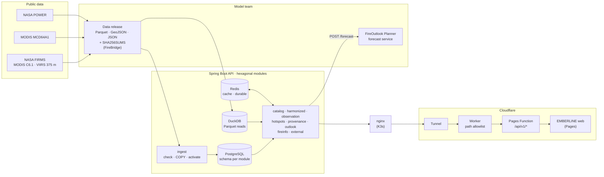

<div align="center">

# 🔥 EMBERLINE — Backend

**Harmonized MODIS–VIIRS fire activity, served as an open API.**

**English** | [한국어](README.ko.md)

[](https://www.spaceappschallenge.org/)
[](https://openjdk.org/projects/jdk/21/)
[](https://spring.io/projects/spring-boot)
[](https://spring.io/projects/spring-modulith)
[](https://www.postgresql.org/)
[](https://duckdb.org/)
[](https://redis.io/)
[](https://k3s.io/)
[](https://www.cloudflare.com/)
[](contract/openapi.yaml)

**[🌐 Live demo](https://emberline-9sd.pages.dev)** · **[🖥️ Frontend repo](https://github.com/Nasa-Planetarium/Planetarium-Frontend)** · **[🛰️ Model repo](https://github.com/Nasa-Planetarium/Planetarium-AI)** · **[📜 API contract](contract/openapi.yaml)**

</div>

---

EMBERLINE is our answer to the NASA Space Apps Challenge 2026 challenge **"Harmonization of MODIS and VIIRS Hot Spots"**.
The model team puts MODIS and VIIRS satellite fire detections on one scale (VIIRS S-NPP–equivalent detection counts) and publishes them as release files.
This backend loads those releases and serves them over HTTP (`/api/v1`) for maps, calendars, year-over-year comparison, outlooks and CSV.

> **The model computes, the server serves.** Values are read from the release files and returned **as stored** — never recomputed.
> The live API currently serves data release `v1.2-2026-11-15`.

## Table of contents

- [What it does](#what-it-does)
- [Architecture](#architecture)
- [Data flow](#data-flow)
- [API](#api)
- [Errors](#errors)
- [Caching and rate limits](#caching-and-rate-limits)
- [Quickstart](#quickstart)
- [Deployment](#deployment)
- [Data rules](#data-rules)
- [Display names](#display-names)
- [Project structure](#project-structure)
- [Data sources and credits](#data-sources-and-credits)
- [Team](#team)
- [Contributing](#contributing)

## What it does

| | |
|---|---|
| 🗺️ **One fire record, 2000 → today** | MODIS (Terra, Aqua) and VIIRS (S-NPP, NOAA-20, NOAA-21) detections harmonized by the model team's **FireBridge** models into one monthly series per 0.1° cell and per region. |
| 📅 **Calendar and comparison** | Year × month calendars with the uncertainty band, the value source and the model's verdict against normal years; a per-month comparison with the baseline period and its continuity. |
| 📍 **Hotspots and cells** | Harmonized hotspot points (JSON/CSV), 0.1° cell values (GeoJSON), cell FRP by day and month, and a NASA FIRMS WMS tile proxy. |
| 🔭 **Outlook** | Next-month occurrence probability (0.5° grid and per region) and the **FireOutlook Planner** 30-day outlook for any region, box or polygon (`POST /forecast`). |
| 🔥 **Fire information** | Fire events (Korea and Argentina), FWI per region, spread nowcast, fire regime, and per-satellite data status. |
| 🛡️ **Built to be public** | RFC 9457 errors with stable codes, release-keyed HTTP caching, Redis-backed rate limits, and a public path with no open inbound port (Cloudflare Tunnel). |

## Architecture

A **DDD modular monolith** with a hexagonal (ports and adapters) layout. Each module under `io.emberline` is one boundary; other modules may only use its `api` package (checked by Spring Modulith and ArchUnit).



| Module | Responsibility | DB schema |
|---|---|---|
| `catalog` | Regions (AOI) and boundaries | `catalog` |
| `harmonized` | Region × month values (calendar, comparison, period summaries); daily values read from Parquet | `harmonized` |
| `observation` | 0.1° cell × month values (GeoJSON), cell FRP | `observation` |
| `hotspots` | Harmonized hotspot points — the release's Parquet folders read with DuckDB at request time | — |
| `provenance` | Method description (`m2v_meta.json`), release info, satellite data status | `provenance` |
| `outlook` | Next-month occurrence; FireOutlook Planner 30-day outlook passed through | `outlook` |
| `fireinfo` | Fire events, FWI, spread nowcast, fire regime | `fireinfo` |
| `ingest` | Release check, load, activation, rollback (command line) | `ingest` |
| `external` | NASA FIRMS WMS tile proxy | — |
| `platform` | Rate limits, event transport (Redis Streams), per-schema Flyway | `platform` |
| `shared` | Error responses, HTTP cache headers, path aliases, shared load code | — |
| `audit` `identity` `operations` `reporting` | Boundaries declared only (planned) | — |

Every module has the same shape:

```
<module>/
  domain/                                    pure domain (no Spring — checked by ArchUnit)
  application/port/in|out/                   use cases and ports (DTOs are records)
  application/service/                       use case implementations
  adapter/in/web/                            controllers (thin, call ports only)
  adapter/out/persistence|parquet|cache|...  JDBC, DuckDB and Redis adapters
```

- **SQL lives in files only** — `src/main/resources/sql/<module>/*.sql`. Tests check that each file names only its own schema and that release tables are filtered by release id (`SqlBoundaryTest`).
- **One handler per data case** — missing month, month in progress, value outside its interval and so on each have a handler class chosen from a registry (`EnumMap`). No `switch` (`SourceRulesTest`), so a new case cannot be silently skipped.
- **Event-driven refresh** — activating a release writes `release.activated` to the Modulith JDBC publication registry in the same transaction, then publishes it on Redis Streams. Other pods reload the active release; a 10-second poll backs up a missed event.

| Layer | Stack |
|---|---|
| Language / framework | Java 21, Spring Boot 4.0 (WebMVC, virtual threads) |
| Module boundaries | Spring Modulith 2.0 + ArchUnit |
| Storage | PostgreSQL (one schema per module), Flyway (one set per schema) |
| File reads | DuckDB (JDBC, read-only) — Parquet checked and queried without conversion |
| Bulk load | PostgreSQL `COPY ... FROM STDIN` (tens of millions of cell × month rows) |
| Cache / events | Two Redis instances — cache (region bundles, tiles) and durable (rate-limit buckets, Streams events) |
| Rate limits | Bucket4j (Lettuce, Redis buckets) |
| Geometry | JTS (box and point-in-region checks without PostGIS) |
| Docs | springdoc (`/api/v1/openapi.json`) checked against the contract |

Library versions are pinned in `gradle.lockfile`.

## Data flow

```
Model team GitHub Release data-v1.2-2026-11-15 (Parquet · GeoJSON · JSON + SHA256SUMS)
   │  release folder (EMBERLINE_RELEASE_ROOT/<release_key>/)
   ▼
ingest stage      check files with DuckDB → PostgreSQL COPY into per-release partitions → indexes → ATTACH
ingest activate   --expect-sha256 checks the SHA256SUMS hash → switch the active release → release.activated
   ▼
API (/api/v1)     PostgreSQL (regions, cells, methods) + DuckDB (daily values, hotspot Parquet) + Redis cache
   ▼
Web (Cloudflare Pages) ── Pages Function /api/v1/* ── Worker ── Cloudflare Tunnel ── nginx in the cluster ── API
```

| Step | How | Where |
|---|---|---|
| Check | key format, folder inside the root, `SHA256SUMS` and file hashes, column names and types, code values, duplicate keys, data cases | `docs/INGEST.md` |
| Load | tables are `PARTITION BY LIST (release_id)`: build a partition, COPY (parallel for cell tables), index, `CHECK`, `ANALYZE`, `ATTACH` | `shared/release/load/PgCopy.java`, `docs/INGEST.md` |
| Reject | a rejected release leaves no partition and does not touch the active release | same |
| Roll back | `activate <previous key> --expect-sha256 <its hash>`; older partitions are kept | same |
| Read at request time | `harmonized_cell_day`, residuals, `harmonized_hotspots/`, static-source flags | `harmonized/adapter/out/parquet`, `hotspots/adapter/out/parquet` |

`data_version` = release key + the first 12 hex characters of the `SHA256SUMS` hash. The response headers `X-Data-Version` and `X-Method-Version` tell which release a value came from.

## API

Base path `/api/v1`. Everything is public and read-only (no login, no session, no cookies). The one public POST is `/forecast`, a read-only computation.

| Method and path | What | Format | Status |
|---|---|---|---|
| `GET /version` | API, method and data versions and request limits | JSON | ✅ live |
| `GET /aois` | Regions (`level`, `parent_id`, `q`, cursor pages) | JSON | ✅ live |
| `GET /aois/{aoiId}` | One region | JSON | ✅ live |
| `GET /aois/{aoiId}/boundary` | Region boundary | GeoJSON | ✅ live |
| `GET /aois/{aoiId}/calendar` | Year × month calendar (value, band, source, verdict vs normal) | JSON · CSV | ✅ live |
| `GET /aois/{aoiId}/months/{yearMonth}/comparison` | One month against normal years | JSON | ✅ live |
| `GET /aois/{aoiId}/summary` | Region totals by period (`freq=day\|month`) | JSON · CSV | ✅ live |
| `GET /summaries` | Totals by period for any bbox | JSON · CSV | ✅ live |
| `POST /summary-queries` | Totals by period for a polygon | JSON | 🗓️ planned |
| `GET /hotspots` | Harmonized hotspot points (`bbox` or `aoi_id`, `layer`, cursor pages) | JSON · CSV | ✅ live |
| `GET /cells` | 0.1° cell × month values | GeoJSON | ✅ live |
| `GET /cells/frp` | 0.1° cell FRP (day and month) | JSON | ✅ live |
| `GET /satellite-status` | Per-satellite data status (`freq=day` → `days[]`, `freq=month` → `months[]`) | JSON | ✅ live |
| `GET /methods/current` | Method description of the current release (`m2v_meta.json` as is) | JSON | ✅ live |
| `GET /methods/{methodVersion}` | Method description of a version (current only) | JSON | ✅ live |
| `GET /firms/wms-tiles` | NASA FIRMS WMS tile proxy (clipped to Korea) | PNG | ✅ live |
| `GET /occurrence/grid` | Next-month occurrence probability, 0.5° grid | JSON · CSV | ✅ live |
| `GET /occurrence/aois` | Next-month occurrence probability by region (`parent_id`) | JSON · CSV | ✅ live |
| `GET /fire-events` | Fire events (Korea and Argentina; `bbox` or `aoi_id`, cursor pages) | JSON | ✅ live |
| `GET /fire-events/{eventId}` | One fire event | JSON | ✅ live |
| `GET /aois/{aoiId}/fwi` | FWI of a region (daily value and normal) | JSON | ✅ live |
| `GET /spread-nowcast` | Spread nowcast (`aoi_id` or `bbox`) | JSON | ✅ live |
| `GET /aois/{aoiId}/fire-regime` | Fire regime of a region (by month) | JSON | ✅ live |
| `POST /forecast` | 30-day outlook for a region, box or polygon (FireOutlook Planner, the model function's answer as is) | JSON | ✅ live |

Try it:

```bash
curl https://emberline-9sd.pages.dev/api/v1/version
curl https://emberline-9sd.pages.dev/api/v1/aois/KR/calendar
curl -X POST https://emberline-9sd.pages.dev/api/v1/forecast \
     -H 'content-type: application/json' -d '{"region":"SIDO_51","horizon_days":30}'
```

- **Format**: `?format=json|csv` or `Accept`; no matching format → 406.
- **Path aliases**: the model team's paths (`/api/aoi`, `/api/calendar`, `/api/compare`, `/api/summary`, `/api/hotspots`, `/api/cells`, `/api/status`, `/api/method`, `/api/firms/wms`, `/api/export.csv`, `/api/forecast`) are accepted too. One filter (`HandoffAliasForwardFilter`) forwards them to the canonical path and adds `Link: <canonical>; rel="canonical"`.
- **Limits** (`/version.limits`; `application.yml` `emberline.limits`, `emberline.hotspots`): hotspot period 92 days (reference) / 31 days (all) and 100 deg², page size up to 10,000, daily totals 366 days, monthly totals and calendars 40 years, polygon 5,000 vertices, 10,000 cells, CSV 100,000 rows.

## Errors

Every error is RFC 9457 `application/problem+json`.

| Member | Meaning |
|---|---|
| `type` `title` `status` `detail` `instance` | RFC 9457. `detail` never carries file paths, stack traces, class names, SQL or keys |
| `code` | String code (`invalid_param`, `unknown_aoi`, `rate_limited`, …). **Clients branch on this** |
| `error_no` | Five-digit number `DSSNN`. **Operators locate the failure with this**; numbers are never reused |
| `param` / `errors[]` | The offending parameter(s) |
| `request_id` `method_version` | Tracing |

`DSSNN`: D = area (1 common, 2 catalog, 3 harmonized, 4 observation, 5 ingest/provenance, 6 external, 7 identity/security, 8 reporting/operations, 9 internal), SS = kind (00 format, 01 range/cost, 02 state/conflict, 03 auth/limits, 04 not found, 05 storage/upstream, 09 internal), NN = serial.
All numbers and their cards (why · what · how · opinion) are in [`docs/errors/README.md`](docs/errors/README.md). `ErrorCodeInvariantTest` keeps the `ErrorCode` enum, the contract's `x-error-catalog`, the Korean and English titles and the cards in step. Titles follow `Accept-Language` (Korean or English).

## Caching and rate limits

**HTTP cache** (`HttpCachingAdvice`) — the same request has the same answer until the release changes, so shared caches may keep it.

| Target | `Cache-Control` | Notes |
|---|---|---|
| Release-bound 200/304 | `public, max-age=60, s-maxage=600` | ETag = path template, normalized query, format, data_version, method_version, response shape version |
| `/version` | `public, max-age=0, s-maxage=5, must-revalidate` | clients poll it to notice an activation |
| `POST /forecast` | `no-store` | the server keeps its own cache keyed by the forecast service's version |
| No release | `no-cache` | |

The nginx cache in front of the cluster puts data_version first in its key, so a new release never gets an old answer.

**Redis cache** — per-region monthly bundles (key includes method and data versions) and FIRMS tiles (900 s). If Redis is slow or down, the cache is skipped and the database answers (connect 300 ms, command 500 ms).

**Rate limits** (`RateLimitFilter`, Bucket4j) — the client address is turned into an HMAC before it becomes a key. Over the limit → 429 `rate_limited` (10301) + `Retry-After` + the scope that was hit.

| Scope | Applies to | Default (`application.yml`) |
|---|---|---|
| `ip` | every `/api` request, per caller | burst 100, 50/s |
| `global` | all callers together (per pod) | burst 2,000, 700/s |
| `heavy` | `/cells`, `/hotspots` (+ aliases) | 30/min |
| `tiles` | FIRMS tiles | 240/min |
| `forecast` | `POST /forecast` | its own bucket |
| FIRMS budget | tile requests that miss the cache | 4,500 per 10 min (keeps within the upstream key limit) |

Production values are overridden with `EMBERLINE_RATELIMIT_*`. `X-Forwarded-For` is trusted only from proxies in `EMBERLINE_TRUSTED_PROXIES`.

## Quickstart

**You need**: JDK 21 (Gradle does not download one), PostgreSQL, two Redis instances (cache and durable), and a release folder. Tests use embedded PostgreSQL (linux-amd64 binaries) and embedded Redis.

```bash
./gradlew bootJar                                    # build/libs/emberline.jar
./gradlew test                                       # unit and integration tests
./gradlew archTest                                   # structure rules (ArchUnit, Modulith verify, no switch, SQL boundaries, error numbers)
./gradlew check                                      # test + archTest
node --test tools/test/*.test.mjs                    # public smoke and load tool tests
(cd deploy/cloudflare/worker && node --test test/*.test.js)
```

```bash
# create the schemas (idempotent)
java -jar build/libs/emberline.jar --spring.profiles.active=flyway

# load a release → check its hash → activate → inspect
java -jar build/libs/emberline.jar --spring.profiles.active=ingest stage <release_key>
java -jar build/libs/emberline.jar --spring.profiles.active=ingest activate <release_key> --expect-sha256 <sha256 of SHA256SUMS>
java -jar build/libs/emberline.jar --spring.profiles.active=ingest show <release_key>

# the API (the management actuator uses a separate port — see application.yml)
java -jar build/libs/emberline.jar
```

Ingest exit codes: 0 ok · 3 bad release or key · 4 hash mismatch · 5 state conflict · 1 anything else. The last line is a JSON result.
Pass `--expect-sha256` a hash obtained apart from the release folder, so a folder swapped as a whole is caught.

**Environment variables** (values never live in the repository; `.env` and `*.env` are in `.gitignore`)

| Name | Meaning |
|---|---|
| `SPRING_DATASOURCE_URL` `SPRING_DATASOURCE_USERNAME` `SPRING_DATASOURCE_PASSWORD` | PostgreSQL |
| `EMBERLINE_RELEASE_ROOT` | where the release folders are |
| `EMBERLINE_REDIS_CACHE_URL` | Redis cache |
| `EMBERLINE_REDIS_DURABLE_URL` | Redis durable (rate limits, events) |
| `EMBERLINE_ENV` | Redis key prefix (`em:{env}:`) |
| `EMBERLINE_CORS_ALLOWED_ORIGINS` | allowed origins (comma list; `*` refuses to start) |
| `EMBERLINE_TRUSTED_PROXIES` | trusted proxy ranges |
| `EMBERLINE_FORECAST_URL` | the FireOutlook Planner service |
| `FIRMS_WMS_BASE_URL` `FIRMS_MAP_KEY_FILE` | FIRMS WMS address and the file that holds the MAP_KEY (the key itself is never an environment variable) |
| `EMBERLINE_RATELIMIT_*` `EMBERLINE_FIRMS_BUDGETPERCALLER` | rate limit and FIRMS budget overrides |

## Deployment

| Layer | What | Files |
|---|---|---|
| Image | `eclipse-temurin:21-jre`, non-root user | `deploy/docker/Dockerfile` |
| Cluster | K3s: API Deployment + release load Job (release volume read-only) | `deploy/k8s/planetarium-app.yaml` |
| Forecast service | FireOutlook Planner: the model team's `planetarium.forecast` behind a thin HTTP wrapper, warmed up at start, reachable only from the API | `deploy/forecast/`, `deploy/k8s/planetarium-forecast.yaml` |
| Front proxy | nginx — path allowlist (public GET/HEAD paths and `POST /api/v1/forecast`), data_version-keyed cache, client address cleanup | `deploy/k8s/planetarium.yaml` |
| Tunnel | cloudflared (Cloudflare Tunnel), connected only through Workers VPC — no public hostname | `deploy/k8s/planetarium-tunnel.yaml` |
| Worker | Worker without a public URL: GET/HEAD `/api/v1/*` and `POST /api/v1/forecast`, allowed request headers only | `deploy/cloudflare/worker/` |
| Pages Function | same-origin `/api/v1/*` on the web app → Worker via service binding | `deploy/cloudflare/pages-function-sample/` |
| Script | build image → apply → (optional) load Job → sync the nginx cache key | `deploy/deploy.sh` |

Secrets (database account, FIRMS key, tunnel token) live only in cluster Secrets, never in the repository; host settings stay in an untracked env file. Step-by-step setup and free-plan limits: [`deploy/PUBLIC.md`](deploy/PUBLIC.md). Public smoke test: `tools/public-smoke.mjs`.

## Data rules

| Rule | What the server does |
|---|---|
| Follow the model | Never edits or recomputes release values; verdicts and percentiles are served as in the file |
| The real file wins | If docs and files differ, the file wins; other column names and codes are translated at load time and listed in `aliases_used` |
| Missing month | null is missing, not 0 (`MISSING_MONTH`) |
| Outside the interval | value outside [value_lo, value_hi] is kept and flagged `interval_out_of_range` |
| Inverted interval, negative values | served **as stored** with a load warning — no sorting, clipping or nulling |
| Showing the band | **The frontend's job**: lo = min(lo, hi, value), hi = max(lo, hi, value); no band when lo is null. API and CSV carry the raw values |
| Month in progress | `status = partial`; `value` = total so far with `value_projected` and `as_of_date`; never compared with complete months; days after `as_of_date` are `out_of_range` |
| Outside the release | `status: out_of_range`, every value null |
| Baseline period | the comparison (`/comparison`) serves `aoi_month_compare`'s baseline period, `continuity_ratio` and `continuity_source` as in the file |
| Static heat sources | when the flag file exists, `/hotspots` drops points with `is_static_source = true` |

Case notes: [`docs/cases/`](docs/cases/); load-side cases: [`docs/INGEST.md`](docs/INGEST.md).

## Display names

Names shown on screen. Code, files and JSON values (`value_source`, `method_version`) keep the internal ids.

| Display name | Internal id | Meaning |
|---|---|---|
| FireBridge | `m2v_xgb` | MODIS → VIIRS conversion model (Aqua + Terra) |
| FireBridge-Terra | `m2v_xgb_terra` | conversion model for the Terra-only years |
| FireBridge Uncertainty Band | `m2v_q10_q90` | q10–q90 band of a cell value |
| N20 Bridge | `n20_bridge` | NOAA-20 → S-NPP adjustment |
| FireOutlook Planner | `planner` | region + period outlook behind `POST /forecast` |

The API does not add display names; `m2v_meta.json`'s `display_name` is inside `meta` of `/methods/current` as in the file.

## Project structure

```
.
├── src/main/java/io/emberline/   modules (catalog, harmonized, observation, hotspots, provenance,
│                                 outlook, fireinfo, ingest, external, platform, shared, …)
├── src/main/resources/
│   ├── db/migration/<schema>/    Flyway, one set per module schema
│   └── sql/<module>/             every SQL statement, one file each
├── src/test/                     unit, integration and acceptance tests + small real-valued release fixtures
├── src/archTest/                 structure rules (ArchUnit, Modulith, SQL boundaries, error catalogue)
├── contract/                     openapi.yaml (OpenAPI 3.1), MAPPING.md, path aliases
├── docs/                         DEVIATIONS.md, INGEST.md, errors/, cases/
├── deploy/                       Dockerfile, K3s manifests, forecast service, Cloudflare Worker and Pages Function, deploy.sh
└── tools/                        public smoke and load tools, with their tests
```

## Data sources and credits

Data comes from the model team's release `data-v1.2-2026-11-15` (2000-11 → 2026-11), which uses:

| Source | Used for | Credit |
|---|---|---|
| NASA FIRMS — MODIS C6.1 (Terra, Aqua), VIIRS 375 m C2 (S-NPP, NOAA-20, NOAA-21) | every detection value, WMS tiles | We acknowledge the use of data from NASA's Fire Information for Resource Management System (FIRMS) (https://firms.modaps.eosdis.nasa.gov), part of NASA's Earth Science Data and Information System (ESDIS). |
| MODIS MCD64A1 v061 | model validation, burned area of fire events | doi:10.5067/MODIS/MCD64A1.061 |
| NASA POWER | FWI | |
| Boundaries — admdongkor (CC BY 4.0), geoBoundaries (ADM1 Public Domain, ADM2 CC BY 3.0), Natural Earth (Public Domain) | region list and boundaries | CC BY sources need attribution under the map |

Models: **FireBridge** (MODIS → VIIRS harmonization) and **FireOutlook Planner** (outlook) by the model team — see the [model repo](https://github.com/Nasa-Planetarium/Planetarium-AI).

FIRMS detections are thermal anomalies, not confirmed wildfires: read the values as **detection counts**.
The code in this repository has no license yet (no LICENSE file).

## Team

**Team Planetarium** — NASA Space Apps Challenge 2026.

| Repository | Part |
|---|---|
| [Planetarium-Backend](https://github.com/Nasa-Planetarium/Planetarium-Backend) | this API |
| [Planetarium-Frontend](https://github.com/Nasa-Planetarium/Planetarium-Frontend) | the EMBERLINE web app ([live](https://emberline-9sd.pages.dev)) |
| [Planetarium-AI](https://github.com/Nasa-Planetarium/Planetarium-AI) | models and data releases |
| [nasa-planetarium.github.io](https://github.com/Nasa-Planetarium/nasa-planetarium.github.io) | team and project showcase |

## Contributing

- `main` on GitHub is a synced copy of the managed repository. Propose changes **as pull requests**; accepted changes come back through the next sync. Do not commit to `main` directly.
- Commit messages follow Conventional Commits (`feat:`, `fix(...):`, …).
- **Before committing**: `./gradlew check` must pass (structure rules included). If you touched Cloudflare code, run `node --test` in that folder.
- If the implementation differs from the contract, add a row to `docs/DEVIATIONS.md` (contract · implementation · why). A new error number means updating `ErrorCode`, the contract's `x-error-catalog`, `messages_*.properties` and a card in `docs/errors/` together (tests check this).
- Library versions in `build.gradle.kts` are pinned; ask in the PR description if you need another library.
- Never put secrets, tokens, account details or internal addresses in code, commits, logs or error responses.
